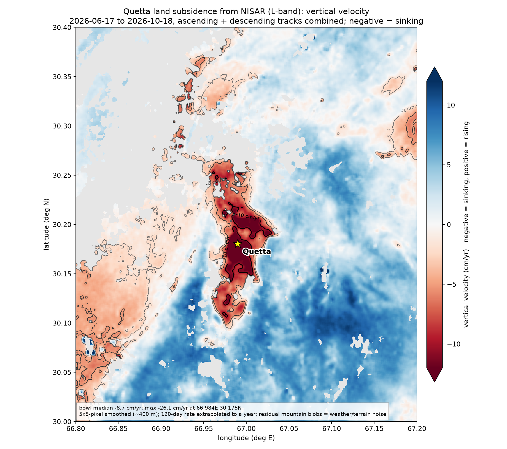

# Explainer: How a Satellite Caught Quetta Sinking

*A plain-language guide to the "Sinking City: Quetta" project for teammates, judges and anyone without a radar background. For the technical details, see [`quetta-subsidence.md`](quetta-subsidence.md) and [`quetta-check/README.md`](quetta-check/README.md).*

---

## In one paragraph

Quetta, a city of more than two million people in Pakistan's dry Balochistan province, is slowly sinking into the ground. The cause is water: the city pumps far more groundwater than rain and snow put back, so the wet clay layers under the valley dry out and squeeze together, like a sponge being pressed. We used a brand-new NASA–ISRO radar satellite called **NISAR** to measure this sinking from space. NISAR shows a sinking bowl right under the city, dropping about **9 cm a year** in the middle, and an independent European satellite agrees. If nothing changes, large parts of the city could sink **another metre or more by 2050**. If pumping is brought under control, most of that is avoided.

---

## 1. Why is Quetta sinking?

1. **Quetta sits in a dry mountain valley.** Rain is scarce, so the city depends on wells.
2. **The city has grown fast**, and so has pumping. The water table is reported to be falling by **one to several metres a year**, and experts warn many wells could run dry within 5–10 years.
3. **Under the valley are layers of clay that hold water.** When the water is pumped out, the clay compacts and doesn't spring back.
4. **So the ground sinks.** Published studies have measured up to **16 cm a year** and up to **2.7 m in total since 2003**.
5. **It doesn't sink evenly.** Where the ground sinks faster in one spot than right next to it, buildings tilt and crack, pipes break, and long cracks called **fissures** can open in the ground.

---

## 2. How can a satellite measure a few centimetres from 700 km up?

**Radar, not a camera.** NISAR doesn't take photos. It sends out microwave pulses and listens for the echo. That works day and night and through clouds and dust.

**Using radar as a ruler.** Each echo carries a very precise timing signal (its *phase*). If NISAR passes over the same spot twice and the ground has moved slightly away, the echo comes back a tiny bit later. Comparing the two echoes measures that movement to within millimetres to centimetres. This technique is called **interferometry**, or **InSAR**.

**Every 12 days.** NISAR revisits Quetta every 12 days, so we can line up many comparisons and watch the ground move over the summer of 2026.

**Two viewing angles tell us the direction.** The satellite looks at the ground at a slant, not straight down. It passes over once heading north (*ascending*) and once heading south (*descending*), looking from opposite sides. Combining the two views lets us separate **straight-down** movement from **sideways** movement. For Quetta, the movement is almost entirely straight down.

---

## 3. What we did, step by step

1. **Found the data.** We searched NASA's archive at the Alaska Satellite Facility for NISAR measurements over Quetta. Each file is about 2.3 GB, so we downloaded only the small piece covering Quetta.
2. **Built a time series.** For each viewing direction, we chained together nine 12-day comparisons from June to October 2026.
3. **Cleaned out false signals.** Water vapour in the air also delays radar echoes, and the effect is stronger over mountains. We used a map of terrain height (the Copernicus DEM) to estimate and remove that effect. We also anchored everything to solid bedrock outside the valley, which shouldn't move.
4. **Measured the speed.** For every 80 m square of ground, we fitted how fast it moved per year, and how certain that number is.
5. **Combined the two viewing angles** into one map of vertical sinking.
6. **Checked it against independent data.** We compared our map with the European Space Agency's Sentinel-1 satellite (2024–2025) and with published studies.
7. **Looked ahead to 2050.** We ran three what-if scenarios and mapped where uneven sinking could damage buildings. We then counted the buildings (from Microsoft's open building map) and people (from WorldPop) in those areas.

---

## 4. What we found

**The main map** ([`quetta-check/final/nisar/vertical_velocity_map.png`](quetta-check/final/nisar/vertical_velocity_map.png)):

**How to read it:**
- **Red = sinking.** The darker the red, the faster.
- **The black lines** mark areas sinking faster than 5 and 10 cm a year.
- **The red bowl runs north–south under the city**, centred near the city centre (the star).
- **Blue areas around the valley are *not* rising ground.** They're a small leftover bias in the processing, about +2 to +4 cm a year. Ignore them.
- **Small red patches on the mountains** are leftover weather effects, not sinking.

**Key numbers:**

| What | Value |
|---|---|
| Typical sinking rate inside the bowl | **about 9 cm per year** (straight down) |
| Area sinking faster than 5 cm/year | 59 km² |
| Area sinking faster than 10 cm/year | 18 km² |
| Sideways movement | essentially none |

---

## 5. How do we know it's real?

We didn't rely on one measurement. Three independent sources agree:

| Source | What it shows |
|---|---|
| **Published studies** (2003–2024, other satellites and GPS stations) | Quetta sinking up to 12–16 cm/year, in the same valley |
| **ESA Sentinel-1** (Sep 2024 – Sep 2025), a different satellite and radar frequency | The same bowl in the same place, about 8 cm/year in the middle |
| **NISAR** (Jun – Oct 2026), our measurement | The same bowl; NISAR and Sentinel-1 agree pixel by pixel with a correlation of **0.89** (1.0 would be perfect) |

Both NISAR viewing directions also see the bowl independently. That's strong evidence the ground is really moving down, not an artifact of one pass.

---

## 6. What could happen by 2050?

These are **scenarios, not predictions**. Nobody can know how much water Quetta will pump in the future, so we asked "what if?" three ways:

| Scenario | What we assume | Area that sinks at least 1 m more by 2050 | Buildings in that area | Buildings in zones at risk of moderate-to-severe cracking |
|---|---|---|---|---|
| **Current trend** | Today's sinking rate continues | ~46 km² | ~49,000 | ~5,500 |
| **Keeps accelerating** | Pumping keeps rising, as it has since 2003 | ~52 km² | ~56,000 | ~12,800 |
| **Pumping controlled** | Pumping is reduced from about 2027–2030 | **~6 km²** | **~7,300** | **~0** |

**How we estimate damage risk:** buildings crack when one side sinks more than the other, not when everything sinks evenly. Engineers measure this as **angular distortion**: how much the ground tilts over a distance. As a rule of thumb, cracks start to appear at around 1 in 500 and serious structural damage begins near 1 in 150. We mapped where the projected tilt crosses those limits.

**The main message:** controlling pumping cuts the area sinking a further metre from about 46 km² to about 6 km², and almost removes the cracking-risk zones. The satellite data shows the problem, and it also shows that action pays off.

We also give the fastest-sinking 1% of the valley: about **3.4–4.5 m more by 2050** if today's rates continued.

---

## 7. What we're careful *not* to claim

- **Short record.** NISAR's usable data so far covers only about four months of 2026 (June–October). That's summer, when pumping is highest, so peak speeds may be overstated. That's why our 2050 numbers use a toned-down annual rate (×0.75), based on how Sentinel-1's full-year rate compares with its summer rate.
- **Early data.** The NISAR files are labelled *provisional* by the mission: good quality, but not yet fully validated.
- **Zones, not houses.** Our map squares are 80 m across, so the damage zones are a **screening tool** to show where to look. They aren't an inspection of individual buildings.
- **A frozen city.** Buildings and population are held at today's numbers, so future exposure is probably *under*-estimated.
- **The 11-month comparison didn't work.** We tried to make one "single picture" spanning almost a year, but the radar signal lost coherence over that long a gap, partly because early test files were mixed with final ones. A shorter, 132-day version works and shows the same pattern, though less clearly.

---

## 8. Glossary

| Term | Meaning |
|---|---|
| **NISAR** | NASA–ISRO Synthetic Aperture Radar, a joint US–India radar satellite (data public since 2026) |
| **SAR** | Synthetic Aperture Radar: a satellite radar that builds sharp images by combining echoes as it moves |
| **L-band** | NISAR's radar wavelength (about 24 cm); it sees through vegetation and stays stable over long periods |
| **InSAR / interferometry** | Comparing two radar passes to measure ground movement |
| **Interferogram** | An image of the difference between two passes; colour rings ("fringes") show movement |
| **Fringe** | One full colour cycle in an interferogram, about 12 cm of movement for NISAR |
| **Line of sight (LOS)** | The slanted direction from the satellite to the ground; raw measurements are along this line |
| **Ascending / descending** | The satellite passing heading north / heading south, looking from opposite sides |
| **Coherence** | How similar the ground looks between two passes (0–1). Low coherence means the measurement can't be trusted. |
| **GUNW / GSLC** | NISAR product types: ready-made comparisons (GUNW) and raw geocoded images (GSLC) |
| **DEM** | Digital Elevation Model: a map of terrain height |
| **Subsidence** | Ground sinking |
| **Angular distortion** | How much the ground tilts across a building's width; the standard measure of damage risk |
| **Sentinel-1** | The European Space Agency's radar satellites, used here as an independent check |

---

## 9. Where things are in the repo

| You want… | Look in |
|---|---|
| The story in one page | this file |
| Full technical brief and sources | [`quetta-subsidence.md`](quetta-subsidence.md) |
| Text for the Space Apps submission form | [`SUBMISSION.md`](SUBMISSION.md) |
| Final NISAR maps and numbers | [`quetta-check/final/nisar/`](quetta-check/final/nisar/) |
| 2050 scenarios and damage zones | [`quetta-check/final/impact/`](quetta-check/final/impact/) (method: `METHODS.md`) |
| How to re-run everything | [`quetta-check/README.md`](quetta-check/README.md) |

*Built with help from AI tools (Anthropic's Claude) for research, code and writing; every number comes from code run on the cited satellite and open datasets. See `SUBMISSION.md` for the full disclosure.*
