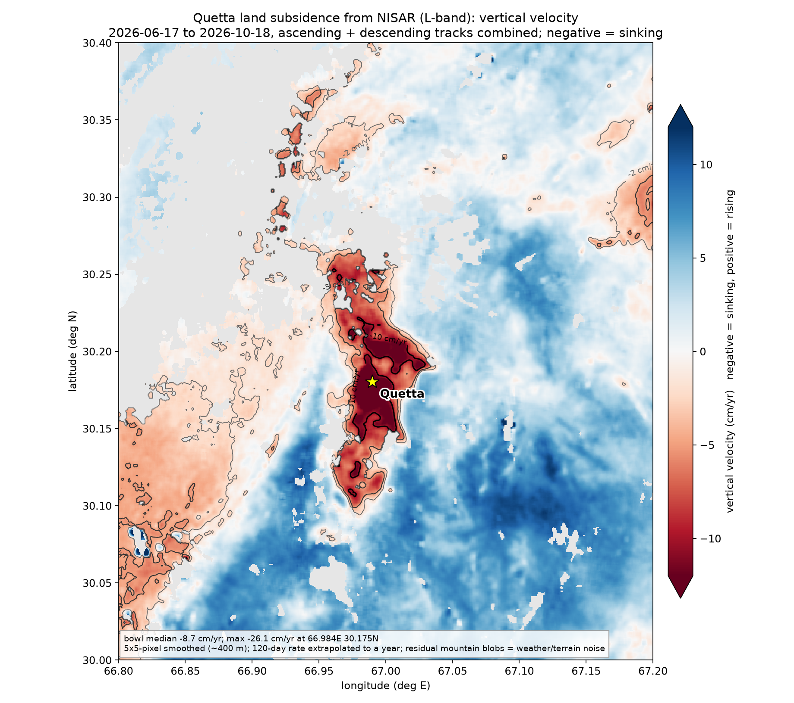

# Sinking City: Quetta — NISAR measures a city going down

> Plain-language version: [`../explainer.md`](../explainer.md). Full brief: [`../quetta-subsidence.md`](../quetta-subsidence.md).

*NASA Space Apps Challenge 2026 · Challenge: "Dancing with the SARs"*

Quetta, Pakistan, is sinking because groundwater is being pumped out faster than it is replaced and the clay beneath the valley is compacting. This project uses radar interferometry from the **NASA–ISRO NISAR** satellite (2026) to measure that sinking from orbit, validates it against **ESA Sentinel-1** data and published studies, and turns it into **risk scenarios to 2050** for buildings and people.



## Key results

| Measurement | Value |
|---|---|
| NISAR vertical velocity, median inside the sinking bowl (Jun–Oct 2026, ascending + descending) | **−8.7 cm/yr** |
| Sentinel-1 equivalent (Sep 2024–Sep 2025, if motion is vertical) | −8.3 cm/yr |
| Pixel correlation, NISAR vertical vs Sentinel-1 across the valley | **r = 0.89** |
| Fastest sinking (≈400 m smoothed) | −26 cm/yr at 66.984°E, 30.175°N (city centre) — see caveats |
| East–west motion in the bowl | ≈ 0 (−0.4 cm/yr) → the ground is moving straight down |
| Valley area sinking faster than 5 / 10 cm/yr | 59 / 18 km² |
| Published rates (2014–2024) | 12–16 cm/yr maximum; up to 2.7 m since 2003 |

**Impact scenarios (2050, annualized rates, median):**

| Scenario | Valley area sunk ≥ 1 m more | Buildings / people there | Buildings in moderate–severe damage-risk zones |
|---|---|---|---|
| Current trend | 46 km² | ~49,000 / ~860,000 | ~5,500 |
| Keeps accelerating | 52 km² | ~56,000 / ~960,000 | ~12,800 |
| Pumping controlled | 6 km² | ~7,300 / ~140,000 | ~0 |

Scenarios, not forecasts. Details, the "as measured" sensitivity run and all assumptions are in [`quetta-check/final/impact/METHODS.md`](final/impact/METHODS.md) (section 10).

## How it works

1. **Find and stream NISAR data.** NISAR Level-2 GUNW interferograms (80 m) over Quetta are located with the ASF DAAC search API; only the Quetta area of each ~2.3 GB HDF5 file is streamed with `earthaccess` + `h5py`.
2. **Build time series.** Nine consecutive 12-day interferograms per track (June–October 2026) are masked (coherence, connected components), referenced to stable bedrock, corrected for terrain-correlated atmospheric delay using the Copernicus DEM, and summed; a per-pixel velocity and its standard error are fitted through all dates.
3. **Vertical vs sideways.** Ascending (track 41) and descending (track 92) line-of-sight velocities are combined using the LOS geometry stored in the files to solve for vertical and east–west motion.
4. **Validate.** NISAR is compared pixel-by-pixel with an independent Sentinel-1 one-year interferogram (COMET LiCSAR) and with published GNSS/InSAR rates.
5. **Project and assess risk.** The vertical-velocity map drives Monte-Carlo scenarios to 2030/2040/2050 (current trend / accelerating / pumping controlled). The slope of the projected sinking surface (angular distortion) is compared with standard geotechnical damage thresholds and intersected with open building footprints and population data.

## Repository layout

| Path | Contents |
|---|---|
| [`quetta-subsidence.md`](../quetta-subsidence.md) | Full project brief: problem, evidence, data, viability, scenario design, sources |
| [`SUBMISSION.md`](../SUBMISSION.md) | Text for the Space Apps project page |
| [`challenge-statement.md`](../challenge-statement.md) | Challenge summary and resources |
| [`quetta-check/final/nisar/`](final/nisar/) | **Final NISAR products**: vertical/east/LOS velocity GeoTIFFs, maps, validation figure, `summary.json`, scripts |
| [`quetta-check/final/impact/`](final/impact/) | **2050 scenarios and damage-risk zones**: GeoTIFFs, figures, `summary.json`, `exposure.csv`, `METHODS.md`, scripts |
| [`quetta-check/final/moneyshot/`](final/moneyshot/) | Long-span NISAR GSLC interferograms (132-day coherent; 336-day decorrelated) |
| [`quetta-check/pipeline/`](pipeline/) | NISAR GUNW streaming and time-series pipeline (`nisar_quetta.py`) with tests |
| [`quetta-check/nisar/`](nisar/) | First NISAR runs (before terrain correction) and comparisons |
| [`quetta-check/sentinel1/`](sentinel1/) | Sentinel-1 validation maps (ascending, descending wrapped phase) and scripts |
| [`quetta-check/preview-stack/`](preview-stack/) | Early attempt using NISAR public preview images (inconclusive) |
| [`nisar-check/`](../nisar-check/) | Earlier exploratory check of Punjab floods with NISAR |

## Reproduce

Requirements: Python 3.11+, a free NASA Earthdata account.

1. **Earthdata login (Windows):** create `%USERPROFILE%\_netrc` as plain ASCII (PowerShell's `>` writes UTF-16, which fails):
   ```powershell
   Set-Content -Path "$env:USERPROFILE\_netrc" -Value "machine urs.earthdata.nasa.gov login YOUR_USERNAME password YOUR_PASSWORD" -Encoding ascii
   ```
   (On macOS/Linux use `~/.netrc`.) Log in once at <https://search.asf.alaska.edu> to approve ASF data access.
2. **NISAR time series:**
   ```bash
   cd quetta-check/pipeline   # from the repo root
   python -m venv venv
   ./venv/Scripts/python -m pip install earthaccess h5py numpy matplotlib tifffile pyproj pytest
   ./venv/Scripts/python -I nisar_quetta.py auth-check
   ./venv/Scripts/python -I nisar_quetta.py run --track 41 --frame 17 --plane
   ./venv/Scripts/python -I nisar_quetta.py run --track 92 --frame 73 --plane
   ```
3. **Final maps (terrain correction, velocities, vertical/east solve):** see [`quetta-check/final/nisar/README.md`](final/nisar/README.md).
4. **Impact scenarios:** see [`quetta-check/final/impact/METHODS.md`](final/impact/METHODS.md); entry point `quetta-check/final/impact/scripts/impact_pipeline.py --rate <vertical_velocity.tif> --rate-unc <uncertainty.tif> --out <dir>`.

## Caveats

- NISAR rates come from **~120 days** (June–October 2026, the summer pumping season) extrapolated to a year. Bowl medians agree with Sentinel-1, but peak values (city centre −18 cm/yr, max −26 cm/yr) exceed the annual Sentinel-1 peak (≈ −14 cm/yr vertical); summer pumping and residual noise likely inflate them. Impact scenarios are therefore run both on the rate **as measured** and **annualized** (×0.75, the Sentinel-1 full-year/summer ratio).
- Residual weather/terrain artifacts remain on the mountains, and areas outside the bowl carry a +2 to +4 cm/yr bias — the blue "rising" areas are **not** real uplift.
- NISAR products used are PROVISIONAL (not fully validated).
- 2050 numbers are **scenarios, not forecasts**; damage classes are zone-level screening at 80 m, not building assessments.
- Tracks 142 and 20 were processed but excluded from the vertical solution as too noisy.

## Data, credits and licences

- **NISAR** (NASA–ISRO Synthetic Aperture Radar) L-band GUNW and GSLC products, PROVISIONAL/V1, distributed by the **ASF DAAC** via NASA Earthdata.
- **Sentinel-1:** contains modified Copernicus Sentinel data (2024–2025), processed by **COMET LiCSAR** (frames 042A_05933_131313, 151D_06038_131313). We acknowledge COMET and the Copernicus programme.
- **Copernicus DEM GLO-30:** © DLR e.V. 2010–2014 and © Airbus Defence and Space GmbH 2014–2018, provided under COPERNICUS by the European Union and ESA.
- **Building footprints:** Microsoft Global ML Building Footprints (ODbL).
- **Population:** WorldPop 2025, 100 m, Pakistan (CC BY 4.0).
- **Published research:** see [`quetta-subsidence.md` §13](../quetta-subsidence.md#13-sources).
- **Software:** Python, numpy, scipy, h5py, earthaccess, pyproj, rasterio, matplotlib, tifffile, scikit-learn.

## Use of AI

This project was built with substantial help from **Anthropic's Claude** (including Claude Code and sub-agents), which was used for literature and documentation research, data discovery, writing the processing and analysis code, running analyses, generating the figures from data, and drafting text. All numbers come from code run on the cited datasets; no figures are AI-generated images. See the "Use of Super Intelligence" section in [`SUBMISSION.md`](../SUBMISSION.md).
